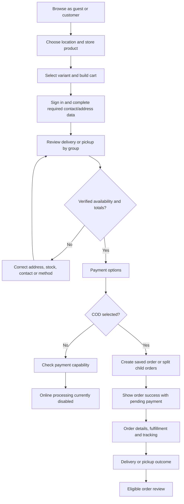
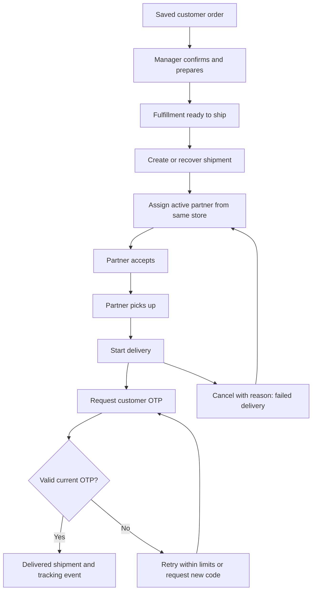

# Workflows and business rules

## Customer purchase journey

Source: CheckoutPage, PaymentOptions, OrderDetailViewPage and OrderReviewPage. A COD split outcome is not the persisted checkout-group transaction.

## Local delivery journey

Service calls are distributed. A successful earlier call followed by failure in a later service may require retry/reconciliation.

## Global-order journey

Customer global eligibility check → saved global order → global approval/stocked-store selection → store preparation → parcel dispatch/tracking.

This is the business flow represented in code, but its implementation is mixed: stocked-store assignment and several parcel operations use the local order store, while order creation/status may be backend-backed. No verified carrier booking or unified persisted approval transaction is established.

## Order state machine

Source: backend [OrderService](../../../ecom-backend/order-service/src/main/java/com/metaarch/order/order/OrderService.java).

| Current | Permitted next status through status update |
|---|---|
| CREATED | CONFIRMED or PROCESSING |
| CONFIRMED | PROCESSING or SHIPPED |
| PROCESSING | SHIPPED |
| SHIPPED | DELIVERED |
| DELIVERED, CANCELLED | No change to a different state |

Repeating the same status returns the current order. Cancellation uses its own endpoint, is allowed before SHIPPED/DELIVERED, and is idempotent once cancelled. The generic status endpoint refuses transition to CANCELLED.

## Fulfillment state machine

Source: backend [FulfillmentService](../../../ecom-backend/fulfillment-service/src/main/java/com/metaarch/fulfillment/fulfillment/FulfillmentService.java).

| Current | Allowed next |
|---|---|
| PENDING | ALLOCATED, CANCELLED, FAILED |
| ALLOCATED | PACKING, CANCELLED, FAILED |
| PACKING | READY_TO_SHIP, CANCELLED, FAILED |
| READY_TO_SHIP | SHIPPED, CANCELLED, FAILED |
| SHIPPED | DELIVERED, FAILED |
| FAILED | PENDING, CANCELLED |
| DELIVERED, CANCELLED | Terminal |

## Shipment state machine

Source: backend [ShipmentService](../../../ecom-backend/fulfillment-service/src/main/java/com/metaarch/fulfillment/shipment/ShipmentService.java).

| Current | Allowed next |
|---|---|
| CREATED | IN_TRANSIT, CANCELLED, FAILED |
| IN_TRANSIT | OUT_FOR_DELIVERY, DELIVERED, CANCELLED, FAILED |
| OUT_FOR_DELIVERY | DELIVERED, FAILED, RETURNED |
| FAILED | CREATED, RETURNED, CANCELLED |
| DELIVERED, RETURNED, CANCELLED | Terminal |

Shipment creation requires READY_TO_SHIP fulfillment. Tracking/assignment endpoints impose additional rules; the existence of a state transition does not grant every role permission to invoke it.

## Payment lifecycle

New orders are PENDING. Verified events can establish success, failure or refund only when payment ID, customer, amount, currency and event status match. Refund cannot precede a paid state. Final refunded state cannot revert. Public arbitrary order-payment-status mutation is denied.

These event rules do not imply an enabled payment provider. The current capability endpoint disables processing and public demo initiation/refund.

## Business-rule register

| ID | Rule | Evidence / feature |
|---|---|---|
| BR01 | Six explicit account roles; dedicated portals do not inherit higher roles | `accessControl`, router; roles |
| BR02 | Registration requires Gmail, valid Indian mobile and strong matching password | Login; C02 |
| BR03 | Customer identity uses token customer ID for service scope | AppContext/Login; C03 |
| BR04 | Item identity includes store, product and variant | AppContext; C07–C09 |
| BR05 | Manual address requires street/city/state/PIN; receiver details required | addressValidation; C10 |
| BR06 | Local delivery must be verified with coordinates and server quote | StoreDeliveryService; S04 |
| BR07 | Pickup has zero delivery charge; global goods are delivery-only | OrderService; O02 |
| BR08 | Backend verifies item prices and rejects duplicate identity | OrderService; O03 |
| BR09 | Handling fee is INR 5 per saved order | OrderService; O03 |
| BR10 | Coupons and nonzero checkout discount are unavailable | couponService/checkoutPolicy; O03 |
| BR11 | Online payment capability is false | PaymentController; O06 |
| BR12 | COD success creates an order, not proof of payment | PaymentOptions; O06 |
| BR13 | Reusing order key with changed request is rejected | OrderCreation; O04 |
| BR14 | Unresolved group attempts must be reconciled before replacement | persistedStoreCheckout; O05 |
| BR15 | Shipped/delivered orders cannot be customer-cancelled | OrderService; O07 |
| BR16 | Finalized shipments cannot be reassigned; failed shipments can retry | ShipmentService; S06 |
| BR17 | Assignment requires active same-store partner in the UI | DeliveryPartnerAssignment; S06 |
| BR18 | Delivery OTP is six digits, 15 minutes, five attempts, 60-second resend | DeliveryOperationsController; D03 |
| BR19 | UI order reviews require delivery; backend currently checks only not-cancelled | OrderReviewPage/Service; O09 |
| BR20 | General reviews require moderation and are local | CustomerFeaturePage; C14 |
| BR21 | Reward redemption is local; 100 points makes value-10 voucher | loyaltyStore; C16 |
| BR22 | Profile deletion UI uses demonstration code; not full account erasure proof | DeleteAccountPage; C18 |
| BR23 | Radius editor creates sorted contiguous bands with unique positive maxima | StoreManagerPortal; S03 |
| BR24 | Reports are order-value summaries, not paid settlement totals | AdminReports; A18 |

## Recovery expectations

Preserve customer intent when requests fail; show the actual error and reload authoritative state before retrying mutations. An order may exist even when the UI saw a timeout. A distributed workflow may have updated one service but not the next. Local fallback success must remain identified as local.

These are operational acceptance expectations grounded in the implemented retry mechanisms; they are not a guarantee that every current branch satisfies them. Relevant discrepancies are in [gaps](gaps.md).
